# SIGS K1 — Sistem Informasi Inventaris Gudang Sembako

<p align="center">
  
</p>

<p align="center">
  <strong>Aplikasi Web Manajemen Inventaris Pergudangan Sembako Berbasis Client-Side</strong><br>
  Proyek Ujian Akhir Semester (UAS) Praktikum Pemrograman Web Dasar &bull; Kelompok K1
</p>

<p align="center">
  
  
  
  
  
  
</p>

<p align="center">
  <a href="./Laporan_Tugas_Besar_PPWD_Kelompok_1.pdf">
    
  </a>
</p>

---

## 📌 Daftar Isi

- [Tentang Proyek](#-tentang-proyek)
- [Laporan Tugas Besar (PDF)](#-laporan-tugas-besar-pdf)
- [Galeri Antarmuka: Wireframe vs Implementasi](#-galeri-antarmuka-wireframe-vs-implementasi)
  - [1. Halaman Masuk (Login)](#1-halaman-masuk-login)
  - [2. Dashboard Inventaris & Valuasi](#2-dashboard-inventaris--valuasi)
  - [3. Kelola Data Produk (Katalog & Pencarian)](#3-kelola-data-produk-katalog--pencarian)
  - [4. Formulir Tambah Produk Baru](#4-formulir-tambah-produk-baru)
  - [5. Modal Ubah Data (Edit In-Place)](#5-modal-ubah-data-edit-in-place)
  - [6. Modal Konfirmasi Hapus Produk](#6-modal-konfirmasi-hapus-produk)
  - [7. Laporan Stok & Valuasi (Filter & Ekspor CSV)](#7-laporan-stok--valuasi-filter--ekspor-csv)
- [Fitur Utama](#-fitur-utama)
- [Akun Demo & Hak Akses](#-akun-demo--hak-akses)
- [Arsitektur & Tumpukan Teknologi](#-arsitektur--tumpukan-teknologi)
- [Struktur Folder](#-struktur-folder)
- [Data Awal Inventaris (8 SKU)](#-data-awal-inventaris-8-sku)
- [Panduan Penggunaan](#-panduan-penggunaan)
- [Cara Menjalankan](#-cara-menjalankan)
- [Keamanan & Best Practices](#-keamanan--best-practices)
- [Informasi Pengembang](#-informasi-pengembang)

---

## 📦 Tentang Proyek

**SIGS K1 (Sistem Informasi Inventaris Gudang Sembako)** adalah sistem manajemen pergudangan sembilan bahan pokok (sembako) yang dibangun secara khusus untuk memenuhi kriteria capaian pembelajaran mata kuliah **Praktikum Pemrograman Web Dasar (CPMK011 & CPMK052)**.

Aplikasi ini mengusung pendekatan **murni sisi klien (*client-side*)** dengan fungsionalitas mirip *Single Page Application* (SPA):
- **Tanpa Backend & Database Server**: Tidak memerlukan konfigurasi server PHP, Node.js, maupun database MySQL/PostgreSQL.
- **Kinerja Cepat & Responsif**: Seluruh modul rendering data, validasi input, penyaringan, pengurutan, kalkulasi nilai aset, hingga ekspor data diproses langsung pada peramban web (*browser*).
- **Persistensi Data**: Menggunakan API `localStorage` modern, sehingga data barang yang ditambah, diedit, atau dihapus tetap tersimpan secara permanen meskipun halaman disegarkan (*refresh*).

---

## 📄 Laporan Tugas Besar (PDF)

Dokumentasi lengkap laporan proyek **Kelompok K1** (mencakup latar belakang, analisis kebutuhan, perancangan wireframe, implementasi kode, dan pengujian sistem) tersedia dalam format PDF langsung di repositori ini:

- 📑 **Berkas Laporan**: [`Laporan_Tugas_Besar_PPWD_Kelompok_1.pdf`](./Laporan_Tugas_Besar_PPWD_Kelompok_1.pdf)

> **Tips**: Klik tautan atau tombol lencana **Laporan Tugas Besar** di atas untuk melihat pratinjau dokumen PDF langsung melalui penampil bawaan GitHub (*GitHub PDF Viewer*) atau mengunduhnya.

---

## 🖼️ Galeri Antarmuka: Wireframe vs Implementasi

Berikut adalah perbandingan komprehensif antara **Rancangan Wireframe (Balsamiq)** dan **Hasil Implementasi Nyata** pada antarmuka web SIGS K1:

### 1. Halaman Masuk (Login)
Form autentikasi pengguna dengan validasi email, pembatasan kata sandi minimal 6 karakter, dan tombol akses cepat (*quick fill*) untuk akun demo.

| Desain Wireframe (Balsamiq) | Hasil Implementasi Nyata |
| :---: | :---: |
| 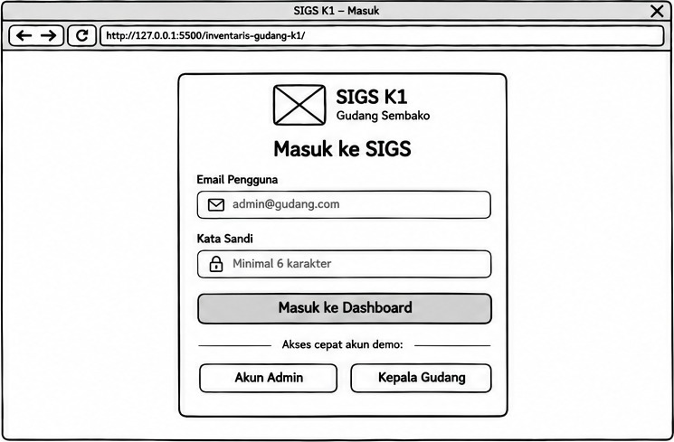 | 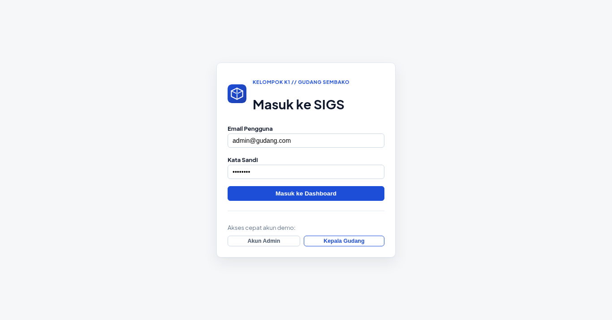 |

---

### 2. Dashboard Inventaris & Valuasi
Pusat kendali eksekutif yang memuat 4 kartu metrik stok, akumulasi nilai valuasi total aset gudang, bilah kesehatan rasio stok aman, tabel prioritas restok kritis, dan grafik distribusi kategori interaktif.

| Desain Wireframe (Balsamiq) | Hasil Implementasi Nyata |
| :---: | :---: |
| 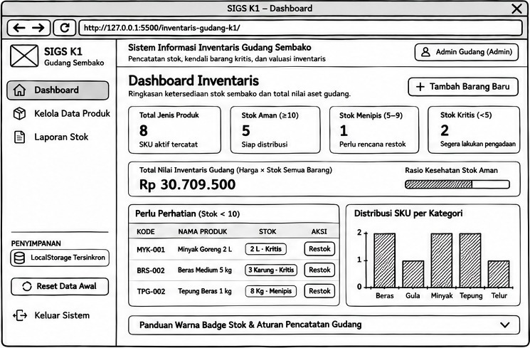 | 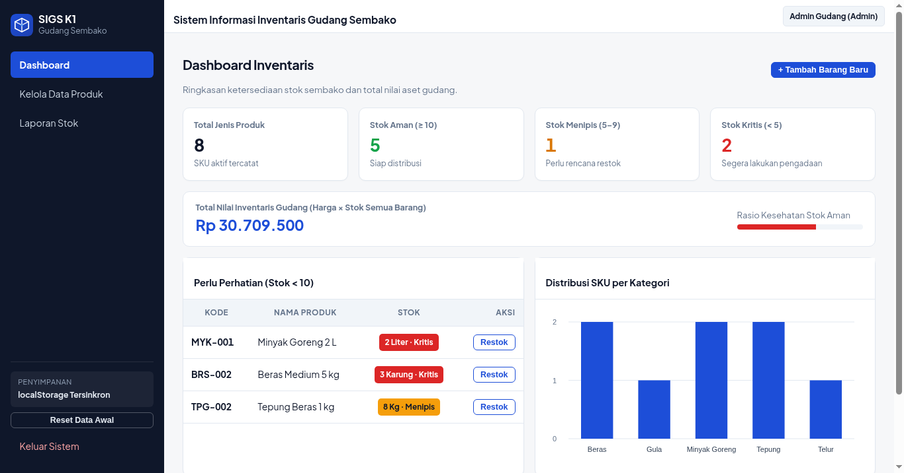 |

---

### 3. Kelola Data Produk (Katalog & Pencarian)
Modul manajemen master produk sembako dengan dukungan beralih tampilan (*Dual View: Tabel & Kartu*), pencarian instan (*live search*), filter kategori, filter tombol khusus stok kritis, pengurutan multikolom, serta kalkulasi subtotal otomatis.

| Desain Wireframe (Balsamiq) | Hasil Implementasi Nyata |
| :---: | :---: |
| 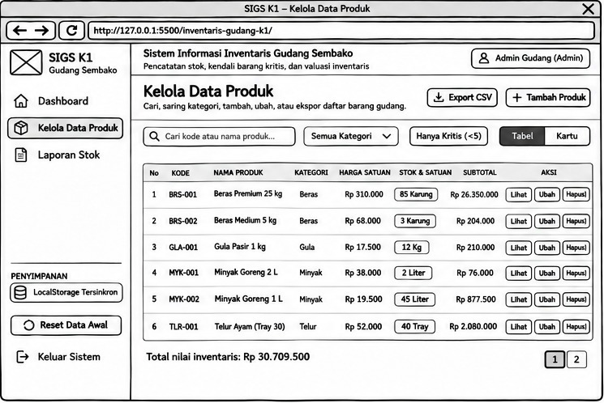 | 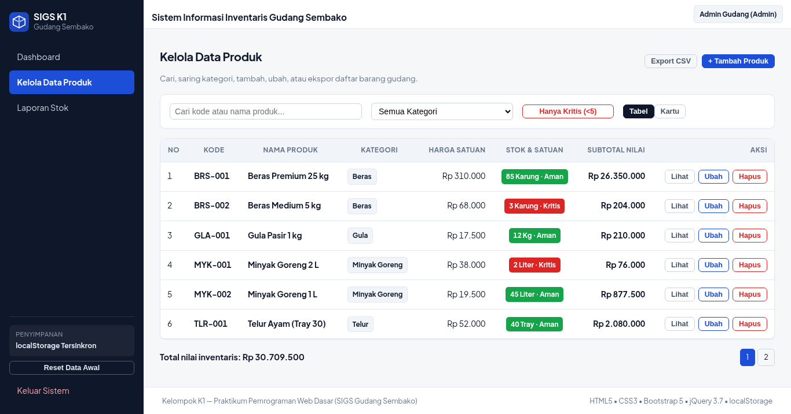 |

---

### 4. Formulir Tambah Produk Baru
Formulir input data barang yang dilengkapi validasi jQuery: format kode wajib `XXX-000` (regex & validasi keunikan SKU), nama produk, kategori, satuan standar, serta harga dan kuantitas stok wajib bernilai positif ($> 0$).

<p align="center">
  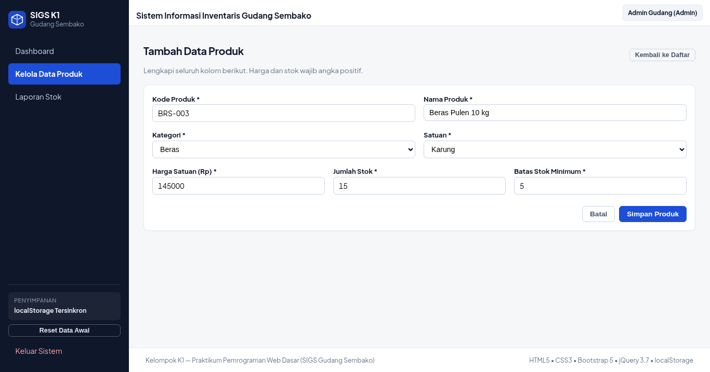
</p>

---

### 5. Modal Ubah Data (Edit In-Place)
Penyuntingan data produk secara langsung menggunakan Modal Dialog Bootstrap tanpa perlu memuat ulang (*reload*) halaman. Kode produk dikunci (*read-only*) untuk menjaga konsistensi integritas identitas SKU.

<p align="center">
  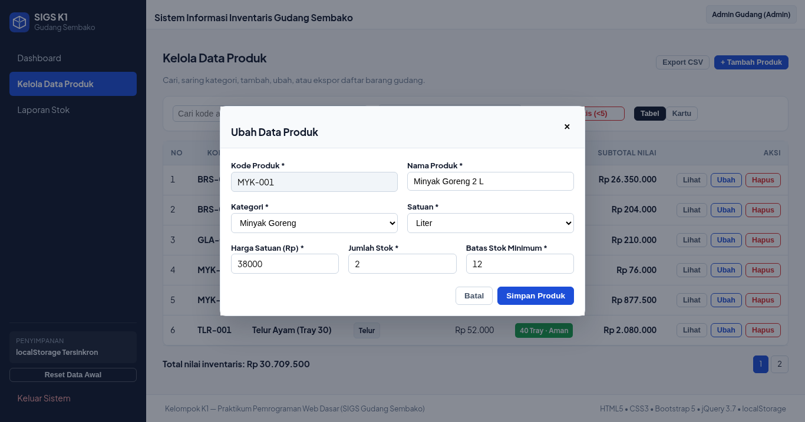
</p>

---

### 6. Modal Konfirmasi Hapus Produk
Dialog pengaman berlapis sebelum produk dihapus dari sistem untuk mencegah kesalahan penghapusan yang tidak disengaja.

<p align="center">
  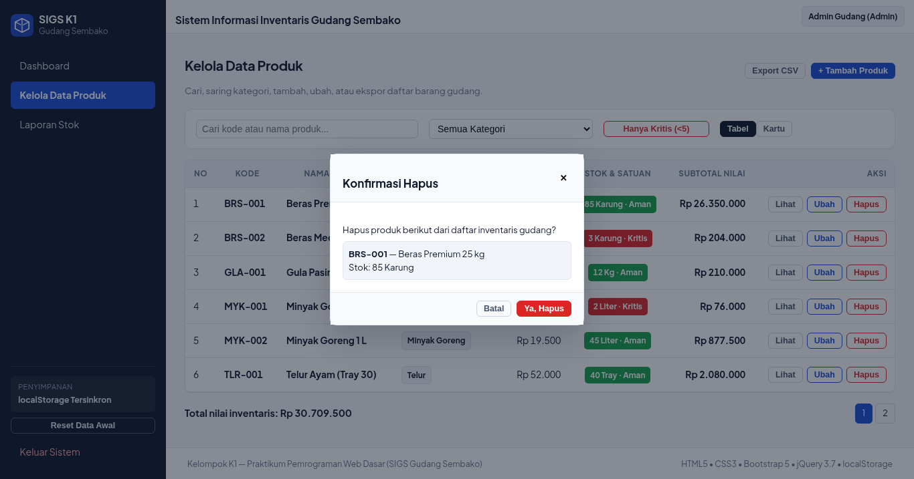
</p>

---

### 7. Laporan Stok & Valuasi (Filter & Ekspor CSV)
Rekapitulasi stok dengan penyaringan bertingkat (berdasarkan kategori, level stok aman/menipis/kritis, dan tanggal). Dilengkapi fitur **Export Laporan CSV** berstandar UTF-8 dengan BOM (`\uFEFF`) yang dapat langsung dibuka dengan rapi di Microsoft Excel.

| Desain Wireframe (Balsamiq) | Hasil Implementasi Nyata |
| :---: | :---: |
| 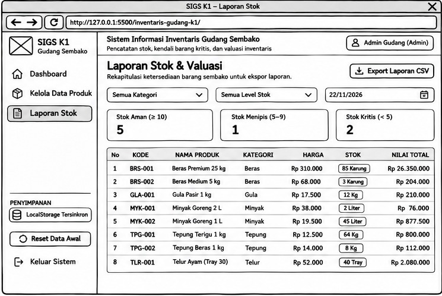 | 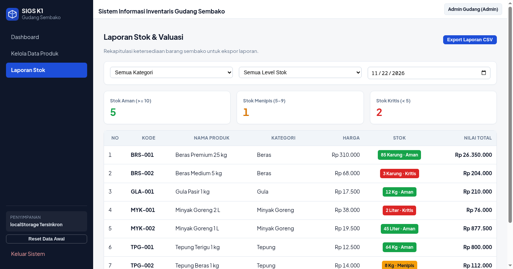 |

---

## 🚀 Fitur Utama

- 📊 **Dashboard Eksekutif**:
  - 4 Kartu Metrik Ketersediaan: Total Produk (SKU), Stok Aman ($\ge 10$), Stok Menipis ($5–9$), dan Stok Kritis ($< 5$).
  - **Valuasi Inventaris Dinamis**: Akumulasi total nilai aset gudang ($\sum \text{Harga} \times \text{Stok}$) secara otomatis dan realtime.
  - **Indikator Kesehatan Stok**: Bar persentase stok aman yang berubah warna sesuai kondisi gudang.
  - **Tabel Peringatan Restok**: Daftar cepat barang berstok $< 10$ yang diurutkan dari yang paling mendesak.
  - **Visualisasi Interaktif (Chart.js)**: Diagram batang (*Bar Chart*) distribusi jumlah SKU per kategori sembako.
- 📋 **Manajemen Produk (CRUD Lengkap)**:
  - **Dual View Mode**: Fleksibilitas memilih tampilan **Tabel Bootstrap** responsif atau **Grid Kartu (Card View)**.
  - **Live Search**: Pencarian instan berdasarkan kode produk atau nama barang tanpa *reload*.
  - **Filter Kategori Dinamis**: Mengelompokkan produk berdasarkan jenis komoditas.
  - **Filter Tombol Khusus Stok Kritis**: Menampilkan produk berstatus kritis ($< 5$) dalam satu kali klik.
  - **Pengurutan Multikolom (*Multi-column Sorting*)**: Urutkan berdasarkan Kode, Nama, Harga Satuan, atau Stok (Ascending/Descending).
  - **Paginasi Otomatis**: Membagi data ke dalam halaman rapi (6 item per halaman).
  - **Subtotal Otomatis**: Perhitungan otomatis nilai per baris barang ($\text{Harga} \times \text{Stok}$).
- 🛡️ **Validasi Formulir Ketat (jQuery Validation)**:
  - Format kode unik SKU berpola `XXX-000` (3 huruf kapital, strip, 3 angka) yang divalidasi via Regex.
  - Pengecekan duplikasi kode SKU saat penambahan barang baru.
  - Validasi batas minimum dan nilai numerik positif ($> 0$) pada harga, stok, dan stok minimum.
- 🔄 **Modal & Interaksi Cepat**:
  - Modal Bootstrap untuk **Ubah Data (Edit)** tanpa navigasi berpindah halaman.
  - Modal konfirmasi keamanan saat **Hapus Barang** dan **Keluar Sistem (Logout)**.
  - Halaman rincian lengkap (*Detail View*) dengan status *read-only*.
- 📑 **Laporan & Ekspor Data (CSV)**:
  - Rekapitulasi laporan dengan filter kategori, status stok, dan tanggal.
  - Fitur **Export CSV** berstandar UTF-8 dengan BOM (`\uFEFF`), sehingga langsung rapi dan terbaca sempurna saat dibuka di Microsoft Excel.
- 💾 **Indikator Penyimpanan & Reset Cepat**:
  - Status badge penyimpanan di sidebar (`localStorage Tersinkron`).
  - Tombol **Reset Data Awal** untuk mengembalikan database kembali ke 8 produk sembako standar bawaan.

---

## 🔑 Akun Demo & Hak Akses

Sistem menyediakan simulasi otentikasi berbasis *role-based access control* lokal dengan tombol isi cepat (*quick fill*) pada form login:

| Peran (*Role*) | Email Akun | Kata Sandi | Deskripsi Hak Akses |
| :--- | :--- | :--- | :--- |
| **Admin Gudang** | `admin@gudang.com` | `admin123` | Akses penuh: Tambah barang, ubah data, hapus produk, lihat detail, ekspor CSV, serta reset data awal. |
| **Kepala Gudang** | `kepala@gudang.com` | `kepala123` | Akses manajerial: Pemantauan dashboard, analisis kesehatan stok, inspeksi laporan, filter level stok, dan ekspor CSV laporan. |

---

## 🛠️ Arsitektur & Tumpukan Teknologi

Aplikasi dirancang dengan arsitektur modular sisi klien yang bersih (*separation of concerns*):

```
┌──────────────────────────────────────────────────────────────┐
│                      Peramban Web                            │
├──────────────────────────────────────────────────────────────┤
│  UI / Markup       : HTML5 Semantik + Font Inter & Mono     │
│  Styling           : CSS3 Variables + Bootstrap 5.3.3        │
│  Komponen Grafis   : Chart.js 4.4.3 (Bar Chart Distribusi)  │
│  Manipulasi & Logik: jQuery 3.7.1 + Vanilla JavaScript (ES6) │
│  Penyimpanan Data  : Web Storage API (localStorage)          │
└──────────────────────────────────────────────────────────────┘
```

### Rincian Dependensi:
- **HTML5**: Semantik dokumen (`<header>`, `<aside>`, `<main>`, `<section>`, `<footer>`).
- **CSS3 & Bootstrap 5.3.3**: Sistem *grid layout*, kartu komponen, modal dialog, formulir input, dan notifikasi toast.
- **Google Fonts**: *Plus Jakarta Sans* untuk keterbacaan teks antarmuka dan *JetBrains Mono* untuk kode barang/angka keuangan.
- **jQuery 3.7.1**: Manipulasi DOM, penanganan *event listener*, traversal elemen, dan validasi form dinamis.
- **Chart.js 4.4.3**: Visualisasi visual data distribusi inventaris barang.
- **localStorage API**: Pengelolaan basis data lokal terstruktur dalam format JSON.

---

## 📂 Struktur Folder

```text
Sistem-Inventaris-Barang-Gudang/
├── index.html          # File antarmuka utama (struktur halaman & seluruh template view)
├── css/
│   └── style.css       # Pengaturan tema visual, variabel palet, sidebar, & responsive breakpoint
├── js/
│   └── script.js       # Logika aplikasi: otentikasi, validasi, manipulasi DOM, CRUD, & localStorage
├── assets/
│   ├── logo-sigs.svg            # Logo vektor resmi aplikasi SIGS K1
│   ├── wireframe-login.jpg      # Wireframe rancangan halaman masuk (login)
│   ├── wireframe-dashboard.jpg  # Wireframe rancangan dashboard inventaris & valuasi
│   ├── wireframe-produk.jpg     # Wireframe rancangan kelola data produk
│   ├── wireframe-laporan.jpg    # Wireframe rancangan laporan stok & valuasi
│   └── screenshots/             # Tangkapan layar hasil implementasi nyata sistem
│       ├── ss-1-login.png       # Tampilan halaman masuk
│       ├── ss-2-dashboard.png   # Tampilan dashboard inventaris & valuasi
│       ├── ss-3-kelola-produk.png # Tampilan kelola data produk
│       ├── ss-4-tambah-produk.png # Tampilan form tambah produk
│       ├── ss-5-modal-edit.png  # Tampilan modal edit produk
│       ├── ss-6-modal-hapus.png # Tampilan modal konfirmasi hapus
│       └── ss-7-laporan-stok.png# Tampilan laporan stok & valuasi
├── Laporan_Tugas_Besar_PPWD_Kelompok_1.pdf  # Dokumen laporan resmi proyek (PDF)
└── README.md           # Dokumentasi komprehensif proyek
```

---

## 🌾 Data Awal Inventaris (8 SKU)

Saat pertama kali dibuka (atau setelah menekan tombol *Reset Data Awal*), sistem secara otomatis memuat 8 komoditas sembako default:

| Kode SKU | Nama Produk | Kategori | Satuan | Stok | Stok Min. | Harga Satuan | Status Stok |
| :---: | :--- | :--- | :---: | :---: | :---: | :---: | :---: |
| `BRS-001` | Beras Premium 25 kg | Beras | Karung | 85 | 20 | Rp 310.000 | <span style="color:green">● Aman</span> |
| `BRS-002` | Beras Medium 5 kg | Beras | Karung | 3 | 10 | Rp 68.000 | <span style="color:red">● Kritis</span> |
| `GLA-001` | Gula Pasir 1 kg | Gula | Kg | 12 | 15 | Rp 17.500 | <span style="color:green">● Aman</span> |
| `MYK-001` | Minyak Goreng 2 L | Minyak Goreng | Liter | 2 | 12 | Rp 38.000 | <span style="color:red">● Kritis</span> |
| `MYK-002` | Minyak Goreng 1 L | Minyak Goreng | Liter | 45 | 20 | Rp 19.500 | <span style="color:green">● Aman</span> |
| `TPG-001` | Tepung Terigu 1 kg | Tepung | Kg | 64 | 25 | Rp 12.500 | <span style="color:green">● Aman</span> |
| `TPG-002` | Tepung Beras 1 kg | Tepung | Kg | 8 | 15 | Rp 14.000 | <span style="color:orange">● Menipis</span> |
| `TLR-001` | Telur Ayam (Tray 30) | Telur | Tray | 40 | 15 | Rp 52.000 | <span style="color:green">● Aman</span> |

---

## 📖 Panduan Penggunaan

### 1. Halaman Masuk (Authentication)
1. Buka aplikasi, antarmuka akan menampilkan kartu login.
2. Klik tombol **Akun Admin** atau **Kepala Gudang** untuk pengisian kredensial otomatis.
3. Klik tombol **Masuk ke Dashboard**. Sesi aktif akan disimpan di browser.

### 2. Dashboard Inventaris & Valuasi
- Periksa ringkasan stok pada 4 kartu statistik di bagian atas.
- Lihat nilai total valuasi gudang ($\sum \text{Harga} \times \text{Stok}$) dan indikator kesehatan rasio stok aman.
- Tabel **Perlu Perhatian** secara otomatis menyaring barang dengan stok $< 10$ lengkap dengan tombol aksi cepat **Restok**.
- Pantau sebaran komoditas gudang melalui grafik batang **Distribusi SKU per Kategori**.

### 3. Kelola Data Produk (CRUD & View Mode)
- **Beralih Tampilan**: Gunakan tombol *Tabel* atau *Kartu* untuk mengubah visualisasi data.
- **Pencarian Cepat**: Ketikkan nama atau kode barang pada kolom pencarian.
- **Filter**: Pilih kategori pada dropdown atau klik tombol merah **Hanya Kritis (< 5)**.
- **Pengurutan**: Klik header kolom *Kode*, *Nama Produk*, *Harga Satuan*, atau *Stok & Satuan* untuk mengurutkan data.
- **Tambah Produk**: Klik tombol `+ Tambah Produk`, lengkapi form, lalu simpan.
- **Ubah Produk**: Klik tombol `Ubah` pada baris produk untuk membuka modal penyuntingan.
- **Hapus Produk**: Klik tombol `Hapus` dan konfirmasi pada modal dialog penghapusan.

### 4. Validasi Form & Aturan Input
Sistem mengimplementasikan validasi input yang ketat:
- **Kode Produk**: Wajib format `XXX-000` (contoh: `BRS-003`). Sistem menolak kode yang sudah ada (*duplicate check*).
- **Nama Produk**: Minimal 3 karakter dan maksimal 80 karakter.
- **Kategori & Satuan**: Wajib dipilih dari opsi dropdown yang tersedia.
- **Harga & Stok**: Wajib berupa bilangan bulat positif ($> 0$). Nilai nol, minus, maupun huruf akan ditolak.

### 5. Laporan & Ekspor CSV
1. Masuk ke menu **Laporan Stok** pada sidebar navigasi.
2. Tentukan kriteria filter berdasarkan kategori, level stok (Aman/Menipis/Kritis), atau tanggal laporan.
3. Klik tombol **Export Laporan CSV** (atau **Export CSV** pada halaman Kelola Produk).
4. Berkas `.csv` akan otomatis terunduh dengan format penamaan `inventaris-gudang-k1-YYYY-MM-DD.csv`.

### 6. Penyimpanan & Reset Data
- Seluruh perubahan data langsung disinkronkan ke `localStorage` di bawah kunci:
  - `sigs_k1_produk_v1` : Menyimpan array koleksi produk.
  - `sigs_k1_sesi_v1` : Menyimpan sesi pengguna yang sedang masuk.
- Jika ingin mengembalikan data ke kondisi semula, klik tombol **Reset Data Awal** pada bagian bawah sidebar.

---

## 💻 Cara Menjalankan

Aplikasi ini dapat dijalankan dengan sangat mudah tanpa perlu menginstal dependensi khusus:

### Metode 1: Buka Langsung (Offline / File Protocol)
1. Unduh atau clone repositori ini ke komputer Anda:
   ```bash
   git clone https://github.com/MStafsir/Sistem-Inventaris-Barang-Gudang.git
   ```
2. Masuk ke direktori proyek dan buka file `index.html` dengan mengklik dua kali (*double click*) atau klik kanan > **Buka dengan (Open with)** browser seperti Google Chrome, Mozilla Firefox, Microsoft Edge, atau Safari.

### Metode 2: Menggunakan Local Web Server (XAMPP / VS Code Live Server)
- **Via XAMPP**: Tempatkan folder proyek di dalam direktori `htdocs` (contoh: `C:/xampp/htdocs/Sistem-Inventaris-Barang-Gudang` atau `/Applications/XAMPP/xamppfiles/htdocs/Sistem-Inventaris-Barang-Gudang`), jalankan Apache, lalu akses `http://localhost/Sistem-Inventaris-Barang-Gudang` di browser.
- **Via Live Server (VS Code)**: Buka folder proyek di VS Code, klik kanan pada `index.html`, lalu pilih **Open with Live Server**.

---

## 🔒 Keamanan & Best Practices

- **Sanitasi Output Anti-XSS**: Seluruh data yang dirender ke antarmuka disaring melalui fungsi sanitasi karakter khusus `esc()` untuk mencegah serangan *Cross-Site Scripting*.
- **Standardized Code Structure**: Penamaan variabel dan fungsi yang deskriptif dan konsisten berbahasa Indonesia yang mudah dipahami.
- **Responsive Web Design**: Tata letak dioptimalkan untuk layar ponsel pintar (*mobile*), tablet, hingga layar desktop lebar dengan transisi *sidebar off-canvas*.
- **Aksesibilitas (A11y)**: Dilengkapi dengan atribut ARIA seperti `role`, `aria-label`, `aria-expanded`, serta kontras warna teks dan latar belakang yang memenuhi standar keterbacaan.

---

## 👥 Informasi Pengembang

Proyek ini dikembangkan oleh **Kelompok K1** untuk pemenuhan tugas **Ujian Akhir Semester (UAS) Praktikum Pemrograman Web Dasar**:

- **M. Sholichin T. Srilintang** ([@MStafsir](https://github.com/MStafsir))
- **Riton Stefano** ([@RitonStefano](https://github.com/RitonStefano))

---

<p align="center">
  &copy; 2026 <strong>Kelompok K1</strong> &bull; Praktikum Pemrograman Web Dasar
</p>
